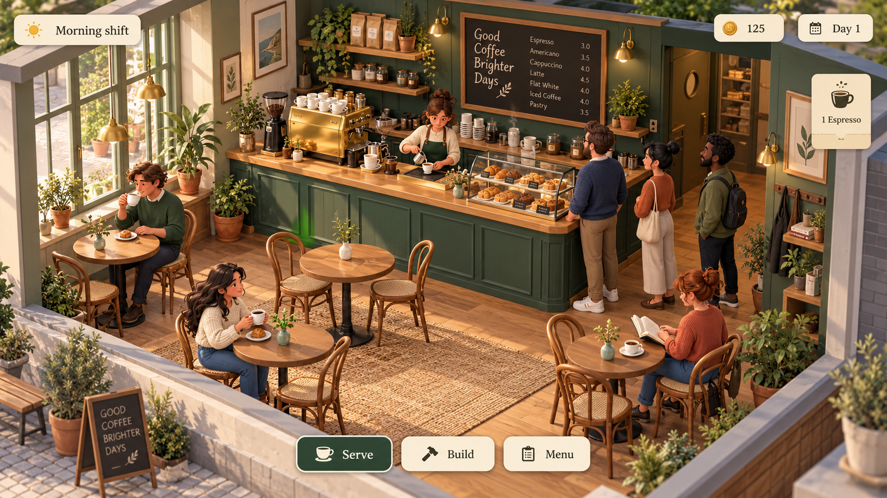

# CafeGame — design brief

## Vision

Create a welcoming neighborhood café that players enjoy both running and looking after. The emotional promise is **a little coffee, a good morning**: satisfying routines, recognizable regulars, and a small space that gradually becomes your own.

This is a proposed art and interaction direction for the 3D WebEngine browser game. The current prototype establishes brewing, serving, coins, and pause; customers, decorating, progression, and the GUI described below are design targets.

## Player experience

- **Serve:** read an order, prepare a drink, deliver it, and see a clear reward.
- **Improve:** invest earnings in equipment, seating, recipes, and small decorative details.
- **Belong:** learn regulars' preferences and watch the café develop a distinct personality.

Use a relaxed pace with short bursts of activity. Introduce one system at a time. Mistakes should invite recovery, with clear feedback rather than aggressive flashing or punitive interruptions. An initial complete shift should support a short play session; longer progression can grow from that loop.

## Graphic style

**Warm Scandinavian café, expressed as a stylized 3D dollhouse.** Softly beveled forms, recognizable silhouettes, matte surfaces, and selective handcrafted detail. Aim for an inviting miniature environment that remains readable at gameplay distance.

Use medium-detail focal objects such as the espresso machine and pastry case, with simpler repeated furniture. Rounded chair backs, thick ceramic rims, chunky handles, and generous counter edges should remain legible when zoomed out. Wood grain and plaster variation should be subtle; avoid tiny scratches, dense surface noise, and photorealistic skin.

Characters have rounded proportions, simplified faces, expressive poses, and distinct clothing silhouettes. Give customers varied ages, skin tones, bodies, and everyday outfits. A clear apron distinguishes staff. Personality should come from posture and animation rather than expensive facial detail.

### Camera and composition

- Default to an elevated three-quarter view with restrained perspective or an orthographic camera.
- The café occupies roughly 75–85% of the usable viewport. Keep the service counter and queue visible together.
- Cut away foreground walls and ceilings; fade obstructing walls when rotating the camera.
- Support bounded orbit, pan, and zoom. Return-to-default should always be easy to find.
- Keep circulation routes generous. Decoration must not obscure selectable objects or customer status.

### Environment and lighting

Start with a compact café: back-wall service counter, espresso machine, pastry display, four small tables, tall windows, and a few plants. Arrange the queue to one side of the counter so staff and customers have understandable routes.

Warm morning sunlight is the signature lighting state. Pair it with soft ambient fill and restrained brass pendant lights. Use contact shadows to anchor furniture, gentle steam to communicate brewing, and a small highlight to show fresh coffee. Preserve midtone detail; avoid crushed shadows, excessive bloom, and orange lighting over the entire scene.

## Color palette

| Color | Hex | Role |
| --- | --- | --- |
| Forest | `#243C32` | Signature cabinetry, selected controls, primary action fills |
| Sage | `#8FA58B` | Secondary furniture, plants, quiet accents |
| Oat | `#F3E9D2` | GUI surfaces, ceramic highlights, warm plaster |
| Honey oak | `#B98250` | Counters, tables, floors |
| Terracotta | `#C57656` | Pots, upholstery, small character accents |
| Warm brass | `#D7AC5B` | Hardware, coins, rewards, focal details |
| Espresso | `#302B25` | Main text, icons, dark outlines |
| Muted stone | `#D4C9B4` | Dividers, quiet borders, neutral furniture |

Let oat and wood dominate, forest establish identity, and brass/terracotta supply small accents. Avoid making every object a saturated focal point. Use espresso text on oat and oat text on forest for primary GUI combinations. Sage, brass, and terracotta are decorative colors rather than default small-text colors; verify contrast on final rendered components.

## GUI style

The interface should feel like a café menu and a neatly arranged order ticket: warm paper-colored panels, dark readable text, modest rounded corners, thin borders, and soft shadows. Keep functional controls crisp and predictable.

Use a quiet editorial serif for titles and a clean sans-serif for controls, values, and instructions. Initial implementation can use Georgia for headings and the system sans-serif stack for functional text. Use tabular numerals for money and timers. Typical desktop body text is 16 px; keep critical labels at least 14 px and scale the interface for smaller screens.

### Layout

| Area | Content | Behavior |
| --- | --- | --- |
| Top left | Shift/day phase and pause | Small persistent status group |
| Top right | Coins and day count | Stable positions; brief reward feedback |
| Right side | Current order tickets | Drink icon, name, quantity, preparation state |
| Bottom center | Serve, Build, Menu | Compact mode switcher with one clear selection |
| Near selected object | Contextual action | Only show relevant actions; keep the object visible |
| Modal/drawer | Upgrades, settings, recipe details | Explicit close/back control; pause policy communicated |

Keep the ordinary HUD below roughly 20% of the viewport and prioritize the game view. On narrow screens, collapse orders into a bottom sheet with a visible count, and adapt the toolbar without overlapping interaction targets. Pointer hover must never be the only way to discover an action.

### Component rules

- Use an 8 px spacing rhythm, 12–16 px panel corners, and 12–20 px inner padding.
- Primary buttons: forest fill, oat label, simple icon. Secondary buttons: oat fill, espresso label, muted border.
- Target at least 44 × 44 CSS px for touch controls, with separation between neighboring actions.
- Hover: modest border/lightness change. Pressed: slight inset or displacement. Selected: fill plus icon/label treatment.
- Disabled: explicit unavailable state, with a short reason where useful. Do not rely solely on low opacity.
- Keyboard focus: a clearly visible outline. Use semantic buttons and a predictable focus order.
- Icons: simple, consistent silhouettes or rounded strokes; pair unfamiliar icons with labels.

### Feedback and accessibility

Show brewing as a progress indicator with remaining time. A completed drink changes both the world object and its order ticket. Serving gives a short coin increment and a restrained confirmation sound. Queue urgency uses a label/icon plus a progress cue, never color alone.

Keep motion subtle: approximately 120–200 ms for control transitions and 250–400 ms for reward feedback. Respect reduced-motion preferences. Provide separate music, ambience, and effects controls, readable UI scaling, and visible equivalents for audio-only cues. Pause gameplay when explicitly paused or when the browser tab is hidden, consistent with the starter runtime.

## Audio direction

Use intimate, soft café sounds: ceramic clinks, a short grinder burst, espresso hiss, a quiet door bell, and low room chatter. Short customer lines should add personality without repeating constantly. Leave room for optional understated instrumental music.

Prepare ElevenLabs speech and effects offline, review them, and ship approved local files. Playback begins after a user gesture. Keep generated speech optional, with written order information always visible.

## Model and asset direction

Use Tripo3D to explore individual props such as machines, chairs, lamps, and plants. Generate isolated objects against consistent briefs; assemble the café in the engine so scale, navigation, selection, and materials remain controllable.

Normalize accepted models in Blender: metres, Y-up export, sensible floor-level pivots, consistent scale, corrected normals, embedded GLB textures, and simple collision proxies. Remove hidden geometry and oversized textures. Keep provider provenance and usage-rights notes beside approved assets.

Initial working budgets, to be measured and revised on representative devices:

- Repeated small props: roughly 500–3,000 triangles; important machines: up to 10,000.
- Stylized characters: roughly 5,000–15,000 triangles with shared animation rigs where practical.
- Prefer shared 512–1024 px texture sets; reserve 2048 px maps for important assets that justify them.
- Use shared meshes/materials, bounded effects, and limited shadow-casting lights.
- Target smooth desktop play at 60 FPS with scalable quality for a 30 FPS lower-power target. These are targets, not measured guarantees.

Validate the look on both WebGPU and WebGL 2. Build the signature appearance from geometry, materials, and lighting that both renderers can support. Gameplay state stays independent of frame rate and rendering quality.

## Reference image

Generated with the built-in image generation tool on 2026-10-25. The image communicates palette, room composition, warm materials, and a restrained HUD. It is aspirational concept art, not a screenshot of the implemented game. Simplify its fine fabric, foliage, reflections, and surface detail for production; the written brief governs implementation. Customer count, exact typography, and decorative text in the image are illustrative.

The complete generation prompt is saved in [docs/reference/prompt.txt](docs/reference/prompt.txt).

## First visual milestone

1. Replace the blockout with a consistent floor, walls, counter, tables, chairs, and espresso machine.
2. Match the palette and morning lighting while preserving clear navigation and selection.
3. Implement the paper-style HUD and an accessible order ticket for the existing brew/serve loop.
4. Add one staff character and a small set of customers with readable idle, queue, and service animations.
5. Introduce approved café effects, then test readability and performance in both browser renderers.

Accept the milestone when a new player can identify the counter, current order, next action, and reward without instruction; the scene remains readable at small viewport sizes; and the visual style is consistent across approved assets.
